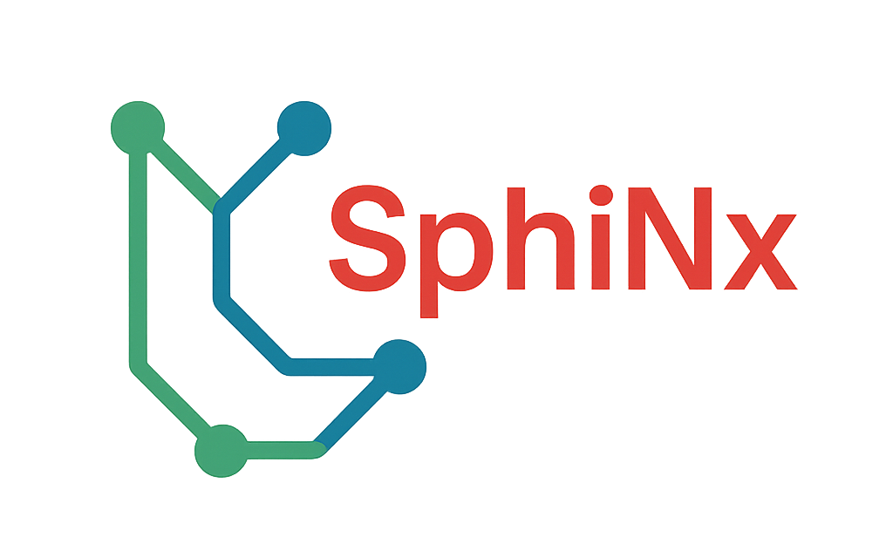

 

This is the entry point for [SphiNx - **Sp**rachmodelle im **h**ybriden **i**ndustriellen **N**utzungskonte**x**t](https://www.forschungsstiftung.bayern.de/projekt/sprachmodelle-im-hybriden-industriellen-nutzungskontext-sphinx/). 

# Objectives
This project investigates the use of large language models in industrial settings, focusing on preserving and sharing expert knowledge while helping integrate lower-skilled workers and non-native speakers. The main technical challenges are largely solved; the harder problems are data protection, liability, and user acceptance. The project addresses these socio-technical issues and aims to deliver an AI chatbot demonstrator that provides expert knowledge in a way that is privacy-compliant, legally sound, and accessible (in language and complexity). Project results will largely be released as open source to benefit small and medium-sized enterprises.

# Associated Repositories
- [ShpiNx-Bot](https://github.com/tivenide/sphinx): Modular prototypes, V0.3.0.
- [mostly-wiki](-	Agentischer Wiki-Workflow: https://github.com/please-insert-name/mostly-wiki) Agentic Wiki-Workflow, based on markitdown (Microsoft) and karpathy-wiki.
- [yanig](https://github.com/spie-mkroehn/yanig)
"Yet Another Natural Intelligence Gedoens" resulting from previous works in DiProLea and Exkimo.

# Disclaimer
This project is supported by "Bavarian Transformation and Research Foundation", Grant AZ-1648-24 ("SphiNx: Sprachmodelle im hybriden industriellen Nutzungskontext")

